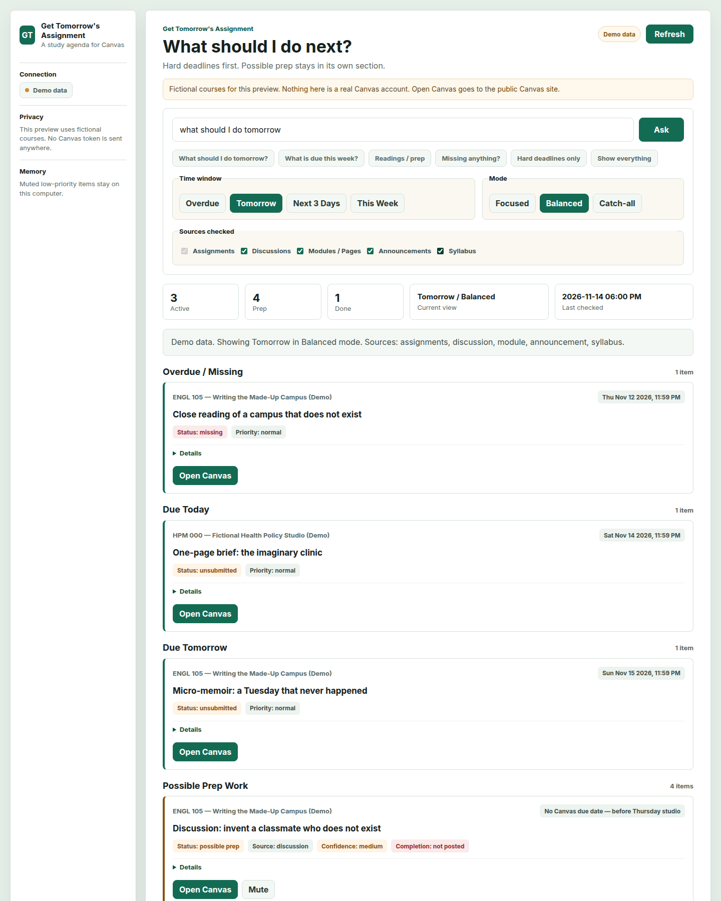
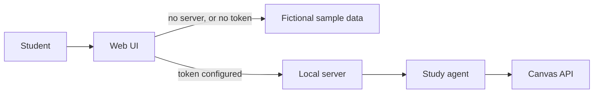

# Get Tomorrow's Assignment

A study agenda that separates what is actually due from the reading and prep you might still need to do.

**Live demo:** [wangsuni0529-bot.github.io/get-tomorrows-assignment](https://wangsuni0529-bot.github.io/get-tomorrows-assignment/)

[](https://github.com/wangsuni0529-bot/get-tomorrows-assignment/actions/workflows/ci.yml)
[](LICENSE)

The demo uses fictional courses. You can click through time windows, modes, and the chat box with no Canvas account and no token.



## The problem

Canvas answers "what assignments have due dates." A student asking "what should I do tomorrow?" needs a second list too: the discussion that is ungraded but expected before class, the page linked from this week's module, the announcement that says to bring an outline.

Those live in different Canvas screens. A 0-point survey can also sit next to a real deadline and feel just as loud. The result is a scavenger hunt every Sunday night.

This project is a personal study tool for that question. It keeps hard deadlines and possible prep in separate sections, and it lets you mute the low-stakes reminders.

## Features

- Hard deadlines grouped into overdue, today, tomorrow, and the rest of the window
- Possible prep, labeled as such, from modules, pages, discussions, announcements, and the syllabus
- A small chat box that turns a question into a time window and a source choice
- Focused, balanced, and catch-all modes, plus source toggles
- Mute for low-priority assignments and noisy prep, stored only on your machine
- A public demo with fictional data, and a local mode that uses your own Canvas token

## How it works



Two paths share one interface.

**Demo.** The page is static HTML, CSS, and JavaScript. If `api/health` is missing, or the local server has no Canvas token, the page builds the agenda from `frontend/demo-data.json`. Dates are relative to today, so "tomorrow" stays tomorrow. Nothing in that file is a real course.

**Your Canvas.** With `CANVAS_BASE_URL` and `CANVAS_TOKEN` in `.env`, the local server reads assignments, submissions, and the ungraded sources above. The browser talks only to `127.0.0.1`. The token stays in the Python process.

The agent is a router, not a language model. "What should I do tomorrow?" becomes `get_study_agenda(days=1, include_prep=true)`. "What is due this week?" turns prep off, because the question asked for deadlines. Off-topic questions get a short boundary and do not call Canvas.

Prep text is scored with conservative rules: an action word plus a time word, a module completion requirement, or a specific sentence in a linked page. The card says possible prep, names the source, and shows the evidence. Linked files are opened only when the URL is on the Canvas host. The token is not attached to any other site.

## Tech stack

- Python 3.10+ for the Canvas client, agenda, and local server
- Canvas REST API
- Vanilla HTML, CSS, and JavaScript
- GitHub Actions for tests, Ruff, and GitHub Pages

## Local setup

```bash
python3 -m venv .venv
source .venv/bin/activate
pip install -r requirements.txt
pip install -e .
cp .env.example .env
```

Create a token in Canvas under Account, Settings, New Access Token. Put it in `.env`:

```text
CANVAS_BASE_URL=https://uncch.instructure.com
CANVAS_TOKEN=your_token_here
```

Start the app and open [http://127.0.0.1:8000](http://127.0.0.1:8000):

```bash
python -m study_agent.web
```

If `.env` has no token, that same page loads the fictional demo. With a token, it reads your courses.

Terminal commands, if you want them:

```bash
python -m study_agent.agent
python -m study_agent.agent "What should I do tomorrow?"
python -m study_agent.agenda --days 7 --include-prep
python -m study_agent.tomorrow
```

Muted items are stored in `.study_agent_memory.json` in the current directory. That file is gitignored.

### Security

A Canvas token can read your courses. Treat it like a password.

- `.env` is gitignored. Do not commit it, screenshot it, or paste it into a chat.
- The server binds to `127.0.0.1`.
- The token is sent only to the Canvas host in `CANVAS_BASE_URL`. Requests to any other site go out without it.
- The public demo has no token and no account.

## Tests

```bash
pytest
ruff check src tests
```

GitHub Actions runs both on every push and pull request.

## Product thinking

A few decisions are the product, not just the implementation.

**Deadlines and prep are different kinds of truth.** An assignment due date is a field Canvas already computed. A sentence in a syllabus is a guess. Mixing them into one "urgent" list would make the tool feel confident when it is not. Possible prep has its own section, a source, a confidence, and the sentence that triggered it.

**Low-priority work can be muted.** Optional items and 0-point items are real, and they are rarely what "what should I do tomorrow?" means. They sit in their own section. Mute hides them next time, on this computer, so the student can teach the tool what to stop repeating.

**The token does not travel.** The useful version for one student is a local process with a personal token. The useful version for anyone else is a static demo with made-up courses. Sending that token to a hosted backend, or attaching it when the app opens a link on another site, would be a different product with a different threat model. That version wants Canvas OAuth, not a pasted token. See [docs/DECISIONS.md](docs/DECISIONS.md).

## Roadmap

- Canvas OAuth, so another student can connect without handing someone a token
- Stronger prep ranking, so a vague syllabus line stays quieter than a page that names Thursday
- A done state for prep Canvas does not grade
- A clearer split between balanced and catch-all, using confidence
- An optional daily digest once the local agenda is trustworthy

## License

MIT, copyright Suni Wang. See [LICENSE](LICENSE).
